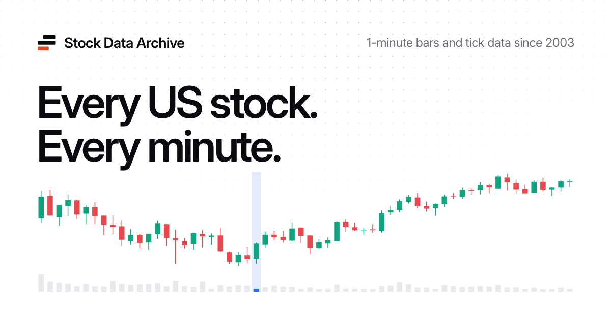

<a href="https://stockdataarchive.com"><picture>
  <source media="(prefers-color-scheme: dark)" srcset="docs/assets/logo-lockup-white.svg">
  <source media="(prefers-color-scheme: light)" srcset="docs/assets/logo-lockup-ink.svg">
  
</picture></a>

### [stockdataarchive.com](https://stockdataarchive.com)

Historical US stock and ETF data for backtesting: 1-minute bars, individual trades and top-of-book quotes in Parquet and CSV. The archive includes listed and delisted symbols, with history back to 2003. Coverage varies by ticker.

[](https://stockdataarchive.com)

This repository contains public examples for trying the website's data and MCP interface.

[Free sample files](https://stockdataarchive.com/free-intraday-data/) · [Ticker coverage](https://stockdataarchive.com/stocks/) · [Delisted stocks](https://stockdataarchive.com/delisted-stocks/) · [Documentation](https://stockdataarchive.com/docs/) · [Pricing](https://stockdataarchive.com/pricing/)

## Run the examples

Use Python 3.10 or later. The examples below need no account or API key.

```sh
git clone https://github.com/stockdataarchive/stock-data-archive.git
cd stock-data-archive
python3 -m venv .venv
source .venv/bin/activate
python -m pip install -r requirements.txt
```

### Inspect a free AAPL file

[examples/aapl_sample.py](examples/aapl_sample.py) downloads the public minute-bar sample, verifies its fingerprint, converts timestamps to New York time and writes a CSV in `.cache/`.

```sh
python examples/aapl_sample.py
```

For November 9, 2026, it finds 846 AAPL bars: 276 pre-market, 390 in the regular session and 180 after hours. A minute with no trades has no bar.

Start with the [website's free samples](https://stockdataarchive.com/free-intraday-data/) to inspect all available files. [examples/sample.sql](examples/sample.sql) contains equivalent DuckDB queries.

### Check historical ticker coverage

[examples/catalogue.py](examples/catalogue.py) connects to the public MCP endpoint and requests ticker coverage, file schemas and sample download URLs.

```sh
python examples/catalogue.py LEH
python examples/catalogue.py AAPL --json
```

The LEH example returns Lehman Brothers' coverage from September 10, 2003 to September 17, 2008. The [website's LEH page](https://stockdataarchive.com/stocks/leh/) shows the same dates. The JSON option prints the full tool results for use in another program.

The MCP interface returns metadata and file URLs. Market observations are read from the downloaded files. The client calls only the public read-only tools and sends no account credentials.

### Compare backtest fill assumptions

[scripts/backtest.py](scripts/backtest.py) uses the free AAPL bars and quotes to compare minute-open fills with quoted ask/bid fills for one opening range breakout.

```sh
python scripts/backtest.py
python -m unittest discover -s tests
```

[Open the worked example](https://stockdataarchive.github.io/stock-data-archive/#finding) to inspect the entry/exit prices, change execution costs, and download the [JSON](docs/results.json) or [CSV](docs/results.csv) results. A [standalone Gist](https://gist.github.com/stockdataarchive/963ae14c7c33c342bcca2f9205573814) is also available.

Both models decide at 10:25 AM Eastern and exit at 3:55 PM. For this one trade, the minute-open model returns $0.975 per share and the quoted ask/bid model $0.870, before fees and extra slippage. This is an execution example for one historical day; it does not establish the strategy's performance across other periods. The study explains the timing and fill assumptions.

## Connect an agent to the website

Public MCP endpoint: `https://stockdataarchive.com/mcp` (Streamable HTTP).

```sh
# Claude Code
claude mcp add --transport http stock-data-archive https://stockdataarchive.com/mcp

# Codex
codex mcp add stock-data-archive --url https://stockdataarchive.com/mcp
```

For Cursor, merge [this configuration](examples/cursor-mcp.json) into `.cursor/mcp.json`.

Example request:

> Check which dates Stock Data Archive has for LEH, then list the free sample files and explain their timestamp columns.

The five public tools check ticker coverage, dataset prices, schemas and samples. `list_purchases` and `list_purchase_files` require the buyer's bearer API token. See the [MCP setup guide](https://stockdataarchive.com/mcp-server/) for supported clients and customer access.

[server.json](server.json) describes the endpoint registered as `io.github.stockdataarchive/stock-data-archive` in the [official MCP Registry](https://registry.modelcontextprotocol.io/v0.1/servers/io.github.stockdataarchive%2Fstock-data-archive/versions/latest). This repository contains examples and setup instructions; the hosted server is maintained at stockdataarchive.com.

## Data and support

Dataset use follows the [Stock Data Archive license](https://stockdataarchive.com/license/).

Questions about files or coverage: [support@stockdataarchive.com](mailto:support@stockdataarchive.com).
